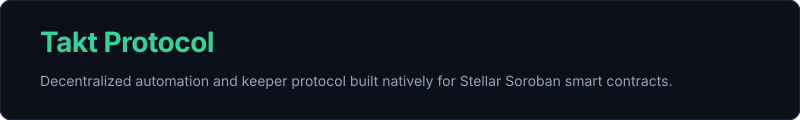

<p align="center">
  
</p>

# Takt Protocol (`takt-app`)

[](https://github.com/takt-protocol/takt-app/actions/workflows/ci.yml)
[](LICENSE)

**Takt Protocol** is an automation and keeper protocol for Stellar Soroban smart contracts. It provides tooling to schedule recurring function calls and state maintenance invocations on Soroban contracts via off-chain keeper polling and on-chain bounty escrows.

### Planned use cases
- Liquidating undercollateralized lending positions
- Automated yield harvesting
- Recurring DAO treasury operations

This repository (`takt-app`) contains the off-chain architecture: the TypeScript SDK, the Go keeper node daemon, and the web application interface.

The on-chain smart contracts (`keeper-registry`, `bounty-vault`, and `job-engine`) are maintained in [`takt-protocol/takt-contract`](https://github.com/takt-protocol/takt-contract).

---

## Architecture Overview

```
                                  +-----------------------------+
                                  |    Web Dashboard (React)    |
                                  |         (apps/web)          |
                                  +--------------+--------------+
                                                 |
                                                 v
+-----------------------------+   +-----------------------------+
|      Go Keeper Node         |   |    TypeScript SDK (@takt)   |
|     (services/keeper)       |-->|       (packages/sdk)        |
+--------------+--------------+   +--------------+--------------+
               |                                 |
               +----------------+----------------+
                                |
                                v
               +---------------------------------+
               |     Stellar Soroban Network     |
               |  (keeper-registry, vault, engine|
               +---------------------------------+
```

### Components

| Directory | Component | Language / Framework | Description |
|-----------|-----------|----------------------|-------------|
| `packages/sdk` | `@takt-protocol/sdk` | TypeScript / `@stellar/stellar-sdk` | Client library for constructing Soroban transactions, parsing error codes, converting stroops, and calculating bounty fee splits. |
| `services/keeper` | `takt-keeper` | Go 1.22 | Lightweight daemon that polls the Soroban RPC for executable automation jobs, signs transactions, and maintains contract TTLs. |
| `apps/web` | `@takt-protocol/web` | React 18 / Vite / Tailwind CSS | Interactive decentralized app for scheduling jobs, depositing vault collateral, staking as a keeper, and inspecting contracts. |

---

## Getting Started

### Prerequisites

- [Node.js](https://nodejs.org/) `>= 20.0.0`
- [npm](https://www.npmjs.com/) `>= 10.0.0`
- [Go](https://go.dev/) `>= 1.22.0`

### Installation

Clone the repository and install workspace dependencies:

```bash
git clone https://github.com/takt-protocol/takt-app.git
cd takt-app
npm install
```

---

## Package Details

### 1. TypeScript SDK (`packages/sdk`)

Build and test the SDK package:

```bash
npm run build --workspace=@takt-protocol/sdk
npm run test --workspace=@takt-protocol/sdk
```

#### Usage Example

```typescript
import { TaktClient, toStroops, calculateBountySplit } from "@takt-protocol/sdk";

const client = new TaktClient({
  network: "testnet",
});

// Build a create_job transaction descriptor
const call = client.buildCreateJobCall({
  owner: "<OWNER_ADDRESS>",
  targetContract: "CDLZFC3SYJYDZT7K67VZ75HPJVIEUVNIXF47ZG2FB2RMQQVU2HHGCYSC",
  targetFn: "harvest_yield",
  intervalSeconds: 300,
  bountyPerRun: toStroops("5.0"),
  maxRuns: 100,
  initialFunding: toStroops("50.0"),
});

// Calculate 5% protocol fee split (500 bps)
const { keeperReward, protocolFee } = calculateBountySplit(toStroops("5.0"), 500);
```

### 2. Keeper Node Service (`services/keeper`)

The keeper node connects to the Soroban RPC network and monitors active jobs for execution readiness.

Build the binary:

```bash
cd services/keeper
go build -o takt-keeper .
```

Configuration environment variables:

| Variable | Default | Description |
|----------|---------|-------------|
| `TAKT_RPC_URL` | `https://soroban-testnet.stellar.org` | Soroban JSON-RPC endpoint |
| `TAKT_KEEPER_SECRET` | *(Required)* | Stellar secret key (S...) for keeper execution and signing |
| `TAKT_POLL_INTERVAL_SECONDS` | `10` | Interval between job state polling cycles |
| `TAKT_API_PORT` | `8080` | Port for the `/health` and metrics HTTP server |
| `TAKT_KEEPER_REGISTRY_ID` | `CDSBDXYELFFHM7XMG4D4BXEVETOHQDWPQOTQLPRHGTTVW7DTNODHIIZN` | KeeperRegistry contract ID |
| `TAKT_BOUNTY_VAULT_ID` | `CDDIJAZCXR7TWSTI4B2FSE7MCXFKH2JVOBT4WELSSJLZHV5XQ4PKHEGO` | BountyVault contract ID |
| `TAKT_JOB_ENGINE_ID` | `CC6ZSDYSGFAZDJ2FP2RT2ZV6NUZN4OFEWYNIS3CYOG2CBG7DIJDCWYOT` | JobEngine contract ID |

### 3. Web Dashboard (`apps/web`)

Run the development server locally:

```bash
npm run dev --workspace=@takt-protocol/web
```

Or build for production deployment:

```bash
npm run build --workspace=@takt-protocol/web
```

---

## Smart Contract Integration

Takt Protocol smart contracts run on Stellar Soroban:

- **Keeper Registry**: Handles keeper staking, unbonding cooldowns, and slashes.
- **Bounty Vault**: Holds collateral escrow for scheduled jobs and enforces 5% protocol fee splits.
- **Job Engine**: Evaluates job execution intervals, verifies keeper eligibility, and invokes target contracts.

### Deployed Stellar Testnet Contracts

| Contract | Address | Explorer |
|----------|---------|----------|
| `keeper-registry` | [`CDSBDXYELFFHM7XMG4D4BXEVETOHQDWPQOTQLPRHGTTVW7DTNODHIIZN`](https://stellar.expert/explorer/testnet/contract/CDSBDXYELFFHM7XMG4D4BXEVETOHQDWPQOTQLPRHGTTVW7DTNODHIIZN) | [Stellar.Expert](https://stellar.expert/explorer/testnet/contract/CDSBDXYELFFHM7XMG4D4BXEVETOHQDWPQOTQLPRHGTTVW7DTNODHIIZN) |
| `bounty-vault` | [`CDDIJAZCXR7TWSTI4B2FSE7MCXFKH2JVOBT4WELSSJLZHV5XQ4PKHEGO`](https://stellar.expert/explorer/testnet/contract/CDDIJAZCXR7TWSTI4B2FSE7MCXFKH2JVOBT4WELSSJLZHV5XQ4PKHEGO) | [Stellar.Expert](https://stellar.expert/explorer/testnet/contract/CDDIJAZCXR7TWSTI4B2FSE7MCXFKH2JVOBT4WELSSJLZHV5XQ4PKHEGO) |
| `job-engine` | [`CC6ZSDYSGFAZDJ2FP2RT2ZV6NUZN4OFEWYNIS3CYOG2CBG7DIJDCWYOT`](https://stellar.expert/explorer/testnet/contract/CC6ZSDYSGFAZDJ2FP2RT2ZV6NUZN4OFEWYNIS3CYOG2CBG7DIJDCWYOT) | [Stellar.Expert](https://stellar.expert/explorer/testnet/contract/CC6ZSDYSGFAZDJ2FP2RT2ZV6NUZN4OFEWYNIS3CYOG2CBG7DIJDCWYOT) |
| `token` (Wrapped Native XLM) | [`CDLZFC3SYJYDZT7K67VZ75HPJVIEUVNIXF47ZG2FB2RMQQVU2HHGCYSC`](https://stellar.expert/explorer/testnet/contract/CDLZFC3SYJYDZT7K67VZ75HPJVIEUVNIXF47ZG2FB2RMQQVU2HHGCYSC) | [Stellar.Expert](https://stellar.expert/explorer/testnet/contract/CDLZFC3SYJYDZT7K67VZ75HPJVIEUVNIXF47ZG2FB2RMQQVU2HHGCYSC) |

For recorded testnet deployment transaction hashes and execution receipts, see the [Testnet Deployment Log](https://github.com/takt-protocol/takt-contract#testnet-deployment-log) in `takt-contract`.

---

## Project Status & Current Limitations

- **Testnet Alpha (Unaudited):** Currently operating on Stellar Testnet (`Test SDF Network ; September 2015`).
- **SDK & Web Transaction Signing:** `@takt-protocol/sdk` constructs validated contract call descriptors (`TaktContractCall`) and queries Soroban RPC; full XDR transaction assembly/signing in the Go keeper (`services/keeper`) and browser wallet signing via `@stellar/freighter-api` in `apps/web` are active roadmap items tracked in open GitHub issues.

---

## Security

Please review [SECURITY.md](SECURITY.md) for information regarding vulnerability reporting and our security policy.

## Contributing

Contributions are welcomed! See [CONTRIBUTING.md](CONTRIBUTING.md) for local development setup and pull request guidelines.

## Maintainers

| Maintainer | Role | Contact |
|---|---|---|
| webdevayo | Core Maintainer | [@dev_ayo](https://t.me/dev_ayo) |

---

## Community

- [Community Chat](https://t.me/+9120mKpa2CpkNjg8)

---

## Contributors

<a href="https://github.com/takt-protocol/takt-app/graphs/contributors">
  
</a>

---

## License

This project is licensed under the [MIT License](LICENSE).
